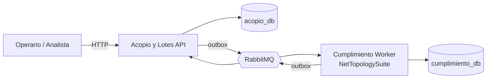

# TrazaCafé Huila

**Trazabilidad finca → lote de exportación y verificación de no deforestación para café del Huila (Reglamento EUDR).**
Proyecto final — *Diseño y Patrones Arquitectónicos* (CORHUILA) · Victor Rojas · 2026.

> ⚠️ Prototipo académico. Todas las fincas y áreas deforestadas son **datos sintéticos**; los resultados no tienen valor probatorio.

## Problema
El Reglamento (UE) 2023/1115, modificado por el Reglamento (UE) 2025/2650, exige demostrar que el café no proviene de tierras deforestadas después del 31-12-2020, con aplicación desde el 30-12-2026 para operadores medianos y grandes. En el Huila, el café de cientos de fincas pequeñas se mezcla en lotes de exportación y los acopios operan con conectividad intermitente. TrazaCafé Huila registra las entregas (incluso sin conexión), conforma lotes con balance de masa, verifica cada finca contra áreas con pérdida de bosque y entrega la **genealogía del lote**: el insumo de la declaración de diligencia debida que presenta el operador en la UE.

## Arquitectura

| Patrón | Dónde se ve | Driver que resuelve |
|---|---|---|
| **Hexagonal** (puertos y adaptadores) | Proyectos `Domain` / `Application` / `Infrastructure` / `Api`·`Worker` por servicio | QA4 · Modificabilidad (cambiar proveedor geoespacial sin tocar el dominio) |
| **Event-Driven** + **Transactional Outbox** + **Inbox** | `BuildingBlocks/Messaging`, tablas `outbox_messages` / `inbox_messages` | QA2 · Aislamiento de fallas · QA3 · Auditabilidad (0 eventos perdidos) |
| **CQRS ligero** | `Application/Comandos` vs `Application/Consultas`; lectura con Npgsql sobre `vw_genealogia_lote` | QA3 · Consulta de genealogía |
| **Microservicios** (2 contextos acotados) | `Acopio y Lotes` (núcleo) · `Cumplimiento` (soporte) | Dependencia externa lenta que escala distinto |
| **Idempotencia + concurrencia optimista** | Hash canónico de `Entrega`, `xmin` en EF Core | QA1 · Integridad (0 kilos duplicados) |



Diagramas completos (C4, componentes, despliegue, secuencias): [`docs/arquitectura/diagramas.md`](docs/arquitectura/diagramas.md) · Decisiones: [`docs/adr/`](docs/adr).

## Stack
.NET 10 (LTS) · ASP.NET Core Minimal APIs · EF Core 10 + Npgsql · PostgreSQL 17 · RabbitMQ 4 (`RabbitMQ.Client` 7) · NetTopologySuite · OpenAPI + Swagger UI · xUnit · Docker Compose.

## Cómo ejecutar

**Prerrequisitos:** Docker Desktop. Para compilar y probar fuera de Docker: .NET SDK 10.

```powershell
docker compose up --build -d      # levanta PostgreSQL, RabbitMQ, la API y el worker
docker compose ps                 # esperar a que todo esté "running"/"healthy"
.\scripts\demo.ps1                # recorrido completo de la demo
```

| Recurso | URL |
|---|---|
| Swagger UI (API) | http://localhost:5080/swagger |
| OpenAPI JSON | http://localhost:5080/openapi/v1.json |
| Salud API / worker | http://localhost:5080/health/ready · http://localhost:5081/health/ready |
| Consola RabbitMQ (trazacafe / trazacafe_dev) | http://localhost:15672 |
| PostgreSQL | `localhost:55432` (trazacafe / trazacafe_dev) |

Reiniciar desde cero (vuelve a correr los scripts de `db/init`): `docker compose down -v`.

## Endpoints

| Método | Ruta | Caso de uso | Respuestas |
|---|---|---|---|
| POST | `/api/entregas/sync` | RF1 · Sincronizar entregas (idempotente) | 200 · 400 · 409 · 422 |
| POST | `/api/lotes` | RF2 · Conformar lote (verificación asíncrona) | 202 · 400 · 404 · 409 · 422 |
| GET | `/api/lotes` | Estado de los lotes | 200 |
| GET | `/api/lotes/{id}/genealogia` | RF4 · Genealogía del lote | 200 · 404 |
| GET | `/api/fincas` | Fincas sintéticas | 200 |
| GET | `/health/live`, `/health/ready` | Salud | 200 · 503 |

Ejemplos listos en [`http/trazacafe.http`](http/trazacafe.http).

## Pruebas
```powershell
dotnet test TrazaCafeHuila.slnx
```
- **Dominio:** invariantes I1–I5 del agregado `Lote`, consentimiento, hash canónico de `Entrega`, regla de la fecha de corte.
- **Idempotencia (aplicación):** reenvío idéntico → 0 kilos y 0 eventos duplicados; mismo id con contenido distinto → conflicto sin efectos; inbox ante redelivery.
- **Adaptador geoespacial:** intersección real con NetTopologySuite.
- **Concurrencia optimista:** `.\scripts\concurrencia.ps1` (dos asignaciones simultáneas de la misma entrega).

## Estructura
```
src/
  TrazaCafe.Contracts/            eventos de integración versionados (published language)
  BuildingBlocks/                 outbox, inbox, RabbitMQ, health checks (sin reglas de negocio)
  Acopio/
    *.Domain/                     Finca, Entrega, Lote (agregado), invariantes
    *.Application/                Puertos, Comandos/, Consultas/  ← CQRS visible
    *.Infrastructure/             EF Core, Npgsql (lectura), manejador de LoteVerificado
    *.Api/                        Minimal APIs, ProblemDetails, OpenAPI, raíz de composición
  Cumplimiento/
    *.Domain/                     ReglaEudr (fecha de corte), ResultadoFinca, VerificacionLote
    *.Application/                IVerificadorDeforestacion (puerto), casos de uso
    *.Infrastructure/             NtsVerificadorDeforestacion (adaptador), EF Core
    *.Worker/                     host del consumidor + /health
tests/                            xUnit
db/init/                          esquema y seed versionados (SQL)
geodata/                          capa sintética de áreas con pérdida de bosque
docs/adr/  docs/arquitectura/     decisiones y diagramas
```

## Limitaciones del MVP (honestidad técnica)
Datos sintéticos; sin autenticación; una sola instancia de PostgreSQL con dos bases lógicas; verificación en memoria (PostGIS como evolución, ADR-006); el sistema genera el **insumo** de la declaración, no la presenta ante el sistema de información de la UE.

## Autor
Victor Rojas — Ingeniería de Sistemas, CORHUILA.

## Licencia
MIT.
