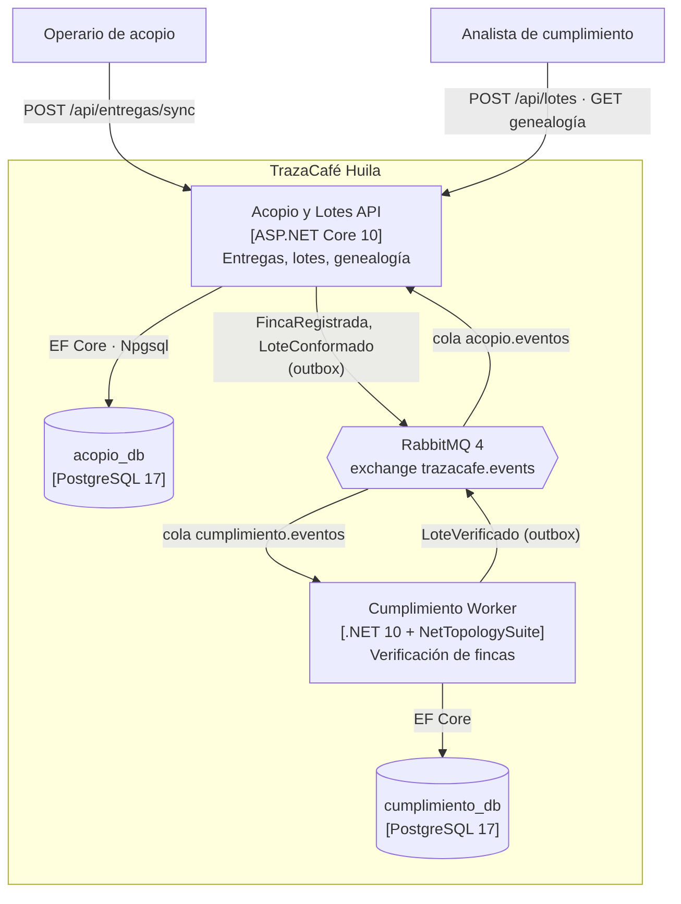
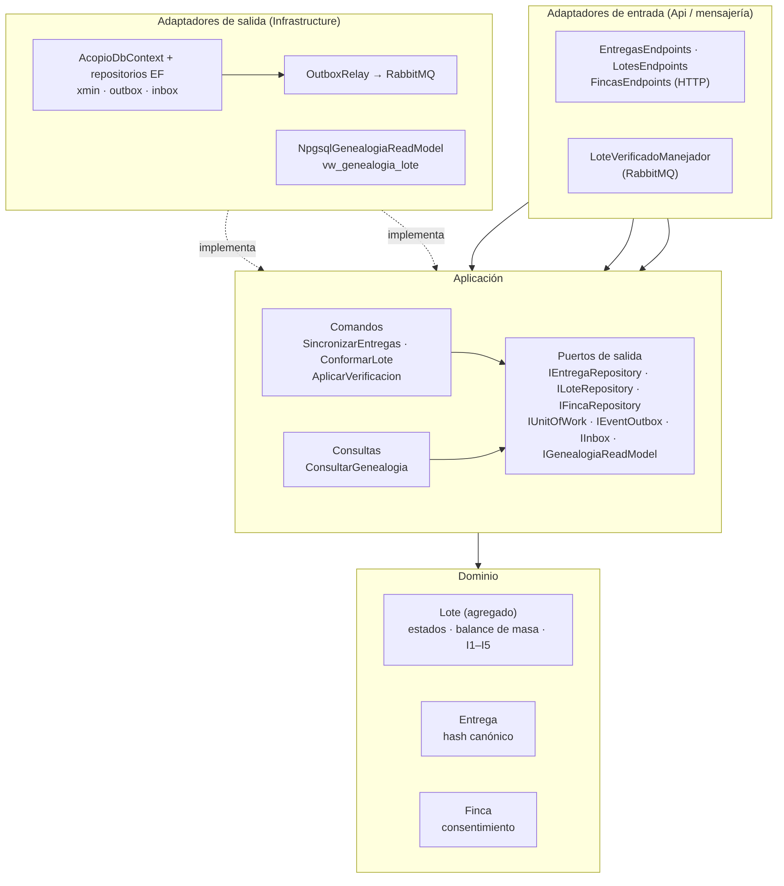
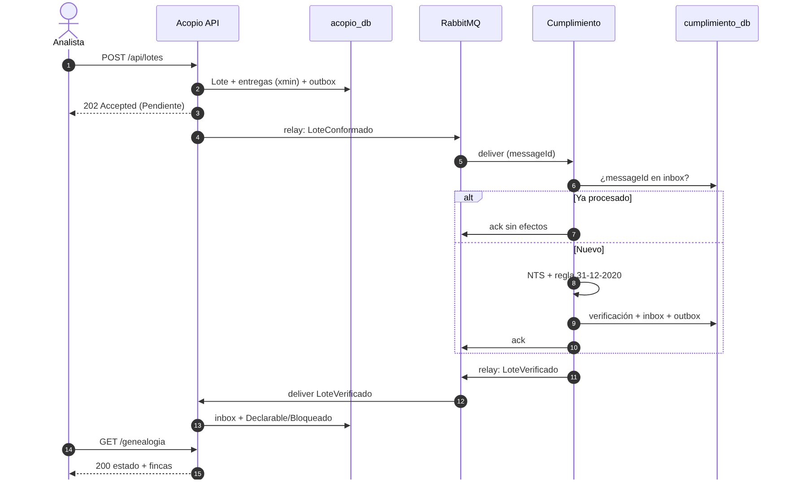

# TrazaCafé Huila

**Trazabilidad finca → lote de exportación y verificación de no deforestación para el café del Huila, frente al Reglamento Europeo sobre Deforestación (EUDR).**


| | |
|---|---|
| **Programa** | Especialización en Arquitectura de Software — Corporación Universitaria del Huila (CORHUILA) |
| **Asignatura** | Diseño y Patrones Arquitectónicos |
| **Docente** | Jesús Ariel González Bonilla |
| **Proyecto** | Proyecto final — Patrones modernos: diseño e implementación de arquitecturas de vanguardia |
| **Autor** | Victor Andres Rojas Meneses |
| **Fecha** | Noviembre de 2026 |

> ⚠️ **Prototipo académico.** Las fincas y las áreas deforestadas son **datos sintéticos**; los resultados no tienen valor probatorio. El sistema genera el *insumo* de la declaración de diligencia debida; la declaración la presenta el operador en la Unión Europea.

---

## Contenido
1. [Problema](#1-problema)
2. [Drivers arquitectónicos](#2-drivers-arquitectónicos)
3. [Arquitectura](#3-arquitectura)
4. [Patrones aplicados y por qué](#4-patrones-aplicados-y-por-qué)
5. [Decisiones de arquitectura (ADR)](#5-decisiones-de-arquitectura-adr)
6. [Stack tecnológico](#6-stack-tecnológico)
7. [Cómo ejecutar](#7-cómo-ejecutar)
8. [Demostración](#8-demostración)
9. [Endpoints](#9-endpoints)
10. [Pruebas](#10-pruebas)
11. [Resultados medidos](#11-resultados-medidos)
12. [Evaluación frente a alternativas](#12-evaluación-frente-a-alternativas)
13. [Estructura del proyecto](#13-estructura-del-proyecto)
14. [Limitaciones y hoja de ruta hacia producción](#14-limitaciones-y-hoja-de-ruta-hacia-producción)
15. [Documentación](#15-documentación)
16. [Autor y licencia](#16-autor-y-licencia)

---

## 1. Problema

El Reglamento (UE) 2023/1115, modificado por el Reglamento (UE) 2025/2650, exige demostrar que el café comercializado en la Unión Europea **no proviene de tierras deforestadas después del 31 de diciembre de 2020**. La obligación aplica desde el **30 de diciembre de 2026** para operadores medianos y grandes, y desde el 30 de junio de 2027 para la mayoría de micro y pequeñas empresas.

En el Huila, el café de muchas fincas pequeñas se recibe en puntos de acopio con **conectividad intermitente** y se mezcla en lotes de exportación. Cuando el exportador pregunta de qué fincas viene un lote, la respuesta se reconstruye a mano. Además, la información de las fincas pertenece al caficultor: compartirla exige su **autorización** (Ley 1581 de 2012).

**TrazaCafé Huila** registra las entregas (incluso sin conexión), conforma lotes con **balance de masa**, verifica cada finca contra **áreas con pérdida de bosque** y entrega la **genealogía del lote**.

## 2. Drivers arquitectónicos

**Requisitos funcionales del MVP**

| ID | Caso de uso |
|---|---|
| RF1 | Sincronizar entregas registradas sin conexión (idempotente) |
| RF2 | Conformar un lote de exportación con balance de masa |
| RF3 | Verificar el lote de forma asíncrona contra pérdidas de bosque posteriores al 31-12-2020 |
| RF4 | Consultar la genealogía del lote (lote → fincas → entregas → verificación) |

**Escenarios de atributos de calidad (estímulo → respuesta → medida)**

| ID | Atributo | Estímulo | Respuesta | Medida |
|---|---|---|---|---|
| QA1 | Integridad | El acopio reenvía entregas ya sincronizadas, idénticas o alteradas | Idénticas: 200 sin efectos. Mismo id con contenido distinto: 409 sin persistir nada | 0 kilos duplicados |
| QA2 | Disponibilidad / aislamiento de fallas | Cumplimiento está caído cuando se conforma un lote | La API responde 202; el evento espera y se procesa al recuperarse | 0 eventos perdidos; estado final ≤ 10 s tras la recuperación |
| QA3 | Auditabilidad | Un auditor pide la genealogía de un lote | Lote, fincas, entregas y verificación con marcas de tiempo | 100 % de kilos trazables; < 500 ms con 200 entregas |
| QA4 | Modificabilidad | Se cambia el proveedor geoespacial | Se agrega un adaptador nuevo | 0 cambios en `Domain` y `Application` |

**Restricciones:** un desarrollador, plazo cercano a 24 horas, despliegue local con Docker Compose, .NET 10, PostgreSQL y RabbitMQ, sin acceso real al sistema de información de la UE ni a un proveedor geoespacial.

## 3. Arquitectura

Dos contextos acotados que se comunican **solo por eventos versionados**, cada uno con su propia base de datos lógica:

- **Acopio y Lotes** (núcleo): fincas, entregas, lotes, balance de masa y genealogía.
- **Cumplimiento** (soporte): verificación geoespacial, que depende de un proveedor externo lento y escala con el número de fincas.

<p align="center"></p>

<details>
<summary><b>Componentes de Acopio y Lotes (arquitectura hexagonal + CQRS ligero)</b></summary>
<p align="center"></p>
</details>

<details>
<summary><b>Secuencia: conformación y verificación asíncrona del lote</b></summary>
<p align="center"></p>
</details>

Todos los diagramas (C4 de contexto y contenedores, componentes, despliegue y dos secuencias) están en Mermaid, versionados en [`docs/arquitectura/diagramas.md`](docs/arquitectura/diagramas.md), y en PNG en [`docs/arquitectura/img/`](docs/arquitectura/img).

## 4. Patrones aplicados y por qué

Cada patrón entra porque resuelve un driver medible, no por moda.

| Patrón | Dónde se ve en el código | Driver que resuelve |
|---|---|---|
| **Hexagonal** (puertos y adaptadores) | Proyectos `Domain` / `Application` / `Infrastructure` / `Api`·`Worker` por servicio; el compilador impide que el dominio dependa de la infraestructura | QA4: cambiar el proveedor geoespacial sin tocar el núcleo |
| **Event-Driven** | Eventos `FincaRegistrada`, `LoteConformado`, `LoteVerificado` en `src/TrazaCafe.Contracts` | QA2: la API no depende de la disponibilidad de Cumplimiento |
| **Transactional Outbox + Inbox** | `BuildingBlocks/Messaging/OutboxRelay.cs`, tablas `outbox_messages` / `inbox_messages` | QA2 y QA3: 0 eventos perdidos; efectos exactamente una vez |
| **CQRS ligero** | `Application/Comandos` vs `Application/Consultas`; la lectura usa Npgsql sobre `vw_genealogia_lote` | QA3: consulta de genealogía rápida y sin pasar por el dominio |
| **Microservicios** (2 servicios) | `Acopio y Lotes API` y `Cumplimiento Worker` | QA2: aislamiento de fallas ante una dependencia externa lenta |
| **Idempotencia + concurrencia optimista** | Hash SHA-256 canónico en `Entrega`; columna `xmin` de PostgreSQL en EF Core | QA1: 0 kilos duplicados; una entrega en un solo lote |

**Descartados a propósito:** Event Sourcing (complejidad sin driver que la pida) y Serverless desde el inicio (sin picos de carga en local; se evalúa como alternativa).

**Reglas del dominio** (agregado `Lote`): I1 al menos una entrega · I2 una entrega pertenece a un solo lote · I3 kilos del lote = suma de sus entregas (balance de masa) · I4 los estados finales no cambian · I5 basta una finca no conforme para bloquear el lote · ninguna finca entra sin consentimiento del caficultor. La **fecha de corte 31-12-2020** vive en el dominio de Cumplimiento (`ReglaEudr`), no en el adaptador geoespacial.

## 5. Decisiones de arquitectura (ADR)

Formato de Michael Nygard (contexto, decisión, alternativas, consecuencias):

| ADR | Decisión |
|---|---|
| [ADR-001](docs/adr/ADR-001-estilo-arquitectonico.md) | Estilo: dos servicios hexagonales orientados a eventos con CQRS ligero; plan B: monolito modular |
| [ADR-002](docs/adr/ADR-002-mensajeria-outbox-inbox.md) | Mensajería confiable: RabbitMQ + Transactional Outbox + Inbox; reintentos con TTL y DLQ; topología como código |
| [ADR-003](docs/adr/ADR-003-replica-de-fincas.md) | Réplica local de geometrías de fincas en Cumplimiento |
| [ADR-004](docs/adr/ADR-004-consistencia-eventual-del-lote.md) | Consistencia eventual explícita: `PendienteVerificacion → Declarable \| Bloqueado`, respuesta 202 |
| [ADR-005](docs/adr/ADR-005-integridad-de-escritura.md) | Idempotencia por id del cliente + hash, y concurrencia optimista con `xmin` |
| [ADR-006](docs/adr/ADR-006-verificacion-geoespacial.md) | NetTopologySuite en memoria detrás de un puerto; PostGIS como evolución |

## 6. Stack tecnológico

| Tecnología | Uso | Por qué |
|---|---|---|
| .NET 10 (LTS), ASP.NET Core Minimal APIs | API y worker | LTS vigente; .NET 8 y 9 terminan soporte el 10-11-2026 |
| EF Core 10 + Npgsql | Escritura | Una transacción para cambios + outbox + inbox; concurrencia con `xmin` |
| Npgsql (ADO.NET) | Lectura | La genealogía no necesita el dominio ni el ORM |
| PostgreSQL 17 | Persistencia | `FOR UPDATE SKIP LOCKED`, `jsonb`, llaves foráneas diferibles |
| RabbitMQ 4 (`RabbitMQ.Client` 7) | Mensajería | Publisher confirms, ack manual, dead-lettering; más liviano que Kafka para este volumen |
| NetTopologySuite | Verificación geoespacial | Intersección de polígonos e índice STRtree sin infraestructura adicional |
| xUnit | Pruebas | Dominio y casos de uso probados sin infraestructura |
| OpenAPI + Swagger UI | Contrato de la API | Documentación navegable |
| Docker Compose | Despliegue local | Todo el entorno con un comando |

Las versiones de los paquetes NuGet están centralizadas en [`Directory.Packages.props`](Directory.Packages.props).

## 7. Cómo ejecutar

### Prerrequisitos
- **Docker Desktop** (suficiente para levantar y probar el sistema).
- **.NET SDK 10** solo si quieres compilar o correr las pruebas fuera de Docker.
- Windows PowerShell 5.1 o PowerShell 7 para los scripts de `scripts/`.

### Levantar todo
```powershell
docker compose up --build -d     # PostgreSQL, RabbitMQ, API y worker
docker compose ps                # esperar postgres y rabbitmq en (healthy)
```

| Recurso | URL |
|---|---|
| Swagger UI | http://localhost:5080/swagger |
| OpenAPI (JSON) | http://localhost:5080/openapi/v1.json |
| Salud de la API | http://localhost:5080/health/ready |
| Salud del worker | http://localhost:5081/health/ready |
| Consola de RabbitMQ | http://localhost:15672 — usuario `trazacafe`, clave `trazacafe_dev` |
| PostgreSQL | `localhost:55432` — usuario `trazacafe`, clave `trazacafe_dev` |

> Las credenciales son **solo para desarrollo local**.

**Reiniciar desde cero** (vuelve a crear el esquema y los datos de prueba de `db/init`):
```powershell
docker compose down -v; docker compose up -d
```

## 8. Demostración

```powershell
powershell -ExecutionPolicy Bypass -File .\scripts\demo.ps1
```

Recorre todo el flujo y muestra:

| Paso | Resultado esperado |
|---|---|
| Sincronizar 6 entregas | `HTTP 200 · creadas=6 duplicadas=0` |
| Reenviar lo mismo (QA1) | `HTTP 200 · creadas=0 duplicadas=6` |
| Mismo id con kilos alterados (QA1) | `HTTP 409 · Entregas en conflicto` |
| Conformar lotes A, B y C | `HTTP 202 · PendienteVerificacion` |
| Reusar una entrega / finca sin consentimiento | `HTTP 422` con el motivo |
| Consistencia eventual | A **Declarable**, B **Bloqueado** (pérdida de bosque en 2023), C **Declarable** (pérdida en 2019, antes del corte) |

**Prueba de resiliencia (QA2):**
```powershell
docker compose down -v; docker compose up -d
docker compose stop cumplimiento-worker
powershell -ExecutionPolicy Bypass -File .\scripts\demo.ps1     # los lotes quedan en PendienteVerificacion
docker compose start cumplimiento-worker
Start-Sleep 10
Invoke-RestMethod http://localhost:5080/api/lotes | Format-Table codigo, estado, conformadoEn, verificadoEn -AutoSize
```

**Otros scripts:**
- `scripts\medir-genealogia.ps1`: mide QA3 (latencia de la genealogía con 200 entregas) y la ventana de consistencia eventual.
- `scripts\concurrencia.ps1`: dos asignaciones simultáneas de la misma entrega; una recibe 202 y la otra 409 (carrera real) o 422.
- `http\trazacafe.http`: el mismo recorrido para VS Code REST Client, Visual Studio o Rider.

## 9. Endpoints

| Método | Ruta | Caso de uso | Respuestas |
|---|---|---|---|
| POST | `/api/entregas/sync` | RF1 · Sincronizar entregas (idempotente) | 200 · 400 · 409 · 422 |
| POST | `/api/lotes` | RF2 · Conformar lote (verificación asíncrona) | 202 · 400 · 404 · 409 · 422 |
| GET | `/api/lotes` | Estado de los lotes | 200 |
| GET | `/api/lotes/{loteId}/genealogia` | RF4 · Genealogía del lote | 200 · 404 |
| GET | `/api/fincas` | Fincas de prueba | 200 |
| GET | `/health/live` · `/health/ready` | Salud (PostgreSQL, RabbitMQ; capa geoespacial en el worker) | 200 · 503 |

Los errores siguen RFC 9457 (`application/problem+json`).

## 10. Pruebas

```powershell
dotnet test TrazaCafeHuila.slnx
```

**34 pruebas automatizadas, todas en verde:**
- **Dominio de Acopio:** invariantes I1–I5 del agregado `Lote`, consentimiento del caficultor, validaciones y hash canónico de `Entrega`.
- **Aplicación de Acopio:** idempotencia de la sincronización (0 kilos y 0 eventos duplicados), conflicto atómico, reenvío parcial, outbox en la misma transacción, inbox ante mensajes repetidos.
- **Cumplimiento:** regla de la fecha de corte (2019 → conforme, 2021/2023 → no conforme), bloqueo del lote y adaptador NetTopologySuite con intersecciones reales.

## 11. Resultados medidos

Mediciones locales (Docker Desktop sobre Windows), desde el cliente y con datos sintéticos. No constituyen una prueba de carga.

| Escenario | Resultado | Meta | Muestra |
|---|---|---|---|
| QA1 · Reenvío idéntico | 0 kilos y 0 eventos duplicados | 0 | 3 corridas + prueba automatizada |
| QA1 · Contenido alterado | 409, nada persistido | 409 atómico | 3 corridas + prueba automatizada |
| QA2 · Operación normal | Mediana 1,50 s (0,85–1,96 s) de conformado a verificado | ≤ 10 s | n = 7 lotes, 3 corridas |
| QA2 · Worker detenido | 0 eventos perdidos; 6/6 lotes resueltos tras esperar 40 s y 201 s en la cola | 0 perdidos | n = 6 lotes, 2 corridas |
| QA3 · Genealogía de 200 entregas | p50 40,6 ms · p95 52,5 ms · máx. 89,2 ms | < 500 ms | n = 50 peticiones (5 de calentamiento excluidas) |
| Sincronización de 200 entregas | 193 ms | — | 1 petición |
| QA4 · Modificabilidad | `Domain` y `Application` sin dependencias de paquetes | 0 cambios en el núcleo | Revisión de proyectos + prueba del adaptador |

## 12. Evaluación frente a alternativas

Comparamos el estilo elegido con un **monolito modular** (mismas capas, eventos en proceso y outbox) y con **Serverless** (Azure Functions + Service Bus), con pesos declarados antes del cálculo a partir de los drivers.

| | 2 servicios EDA (elegido) | Monolito modular | Serverless |
|---|---|---|---|
| Matriz simple (sobre 40) | 26 | **32** | 28 |
| Matriz ponderada (sobre 5) | 3,60 | **3,70** | 3,50 |

**Lectura honesta:** el monolito modular queda ligeramente arriba. La diferencia (0,10) se invierte moviendo 2 puntos de peso hacia el aislamiento de fallas, así que es un **empate técnico**. Que no se pierdan eventos se debe al outbox/inbox, que también funcionaría en un monolito. Lo que **solo** demuestra la separación es que la API siguió respondiendo 202 con Cumplimiento caído. A esta escala, un monolito modular con el verificador como proceso aparte sería igual de defendible.

**Cuándo NO usar este estilo:** sin necesidad real de aislar fallas o escalar por separado; cuando se exige consistencia inmediata entre contextos; con equipos sin experiencia operando brokers y DLQ; con límites de dominio todavía inciertos; con volumen bajo y estable.

## 13. Estructura del proyecto

```
TrazaCafeHuila/
├── src/
│   ├── TrazaCafe.Contracts/            eventos de integración versionados (lenguaje publicado)
│   ├── BuildingBlocks/                 outbox, inbox, RabbitMQ, topología, health checks
│   ├── Acopio/
│   │   ├── TrazaCafe.Acopio.Domain/          Finca, Entrega, Lote (agregado) e invariantes
│   │   ├── TrazaCafe.Acopio.Application/     Puertos/  Comandos/  Consultas/   ← CQRS visible
│   │   ├── TrazaCafe.Acopio.Infrastructure/  EF Core, lectura con Npgsql, consumidor de LoteVerificado
│   │   └── TrazaCafe.Acopio.Api/             Minimal APIs, ProblemDetails, OpenAPI, composición
│   └── Cumplimiento/
│       ├── TrazaCafe.Cumplimiento.Domain/          ReglaEudr, ResultadoFinca, VerificacionLote
│       ├── TrazaCafe.Cumplimiento.Application/     IVerificadorDeforestacion (puerto), casos de uso
│       ├── TrazaCafe.Cumplimiento.Infrastructure/  NtsVerificadorDeforestacion (adaptador), EF Core
│       └── TrazaCafe.Cumplimiento.Worker/          host del consumidor + /health
├── tests/                              xUnit (dominio, aplicación, adaptador geoespacial)
├── db/init/                            esquema y datos de prueba versionados (SQL)
├── geodata/                            capa sintética de áreas con pérdida de bosque
├── scripts/                            demo.ps1, medir-genealogia.ps1, concurrencia.ps1
├── http/                               trazacafe.http
├── docs/
│   ├── adr/                            ADR-001 a ADR-006
│   ├── arquitectura/                   diagramas Mermaid + img/
│   └── entrega/                        documento técnico (Word) y presentación (PowerPoint)
├── docker-compose.yml
├── Directory.Build.props · Directory.Packages.props
└── TrazaCafeHuila.slnx
```

## 14. Limitaciones y hoja de ruta hacia producción

| Semana | Actividades | Estado en el prototipo |
|---|---|---|
| 1 · Arquitectura y esqueleto | CI con GitHub Actions, esquemas formales de eventos, migraciones versionadas | Drivers, vistas, ADR y esqueleto listos; sin CI |
| 2 · Núcleo de Acopio | Pruebas de integración con Testcontainers; purga y archivo del outbox | RF1 y RF2 cubiertos |
| 3 · Cumplimiento | PostGIS (`ST_Intersects` + GiST); trazas y métricas con OpenTelemetry | RF3 y RF4 con NetTopologySuite en memoria |
| 4 · Endurecimiento y despliegue | OIDC y roles; registro del consentimiento; prueba de carga con k6; Azure Container Apps + Azure Database for PostgreSQL | Mediciones locales; sin seguridad ni nube |

Limitaciones actuales: datos sintéticos, sin autenticación, una sola instancia de PostgreSQL con dos bases lógicas, verificación en memoria, outbox sin purga y sin trazas distribuidas.

## 15. Documentación

- **Documento técnico** (APA 7, con membrete institucional): [`docs/entrega/TrazaCafe_Huila_Documento_Tecnico_Membrete.docx`](docs/entrega/TrazaCafe_Huila_Documento_Tecnico_Membrete.docx)
- **Presentación final** (13 diapositivas con notas del orador): [`docs/entrega/TrazaCafe_Huila_Presentacion_Final.pptx`](docs/entrega/TrazaCafe_Huila_Presentacion_Final.pptx)
- **Decisiones de arquitectura:** [`docs/adr/`](docs/adr)
- **Diagramas:** [`docs/arquitectura/diagramas.md`](docs/arquitectura/diagramas.md) · [`docs/arquitectura/img/`](docs/arquitectura/img)

**Referencias principales:** Bass, Clements y Kazman (2021), *Software Architecture in Practice*; Richards y Ford (2020), *Fundamentals of Software Architecture*; Newman (2021), *Building Microservices*; Richardson (2018), *Microservices Patterns*; Evans (2003), *Domain-Driven Design*; Cockburn (2005), *Hexagonal Architecture*; Reglamentos (UE) 2023/1115 y 2025/2650. La lista completa en formato APA está en el documento técnico.

## 16. Autor y licencia

**Victor Andres Rojas Meneses** — Especialización en Arquitectura de Software, Corporación Universitaria del Huila (CORHUILA). Proyecto final de la asignatura *Diseño y Patrones Arquitectónicos*, docente Jesús Ariel González Bonilla.

Distribuido bajo licencia [MIT](LICENSE).
