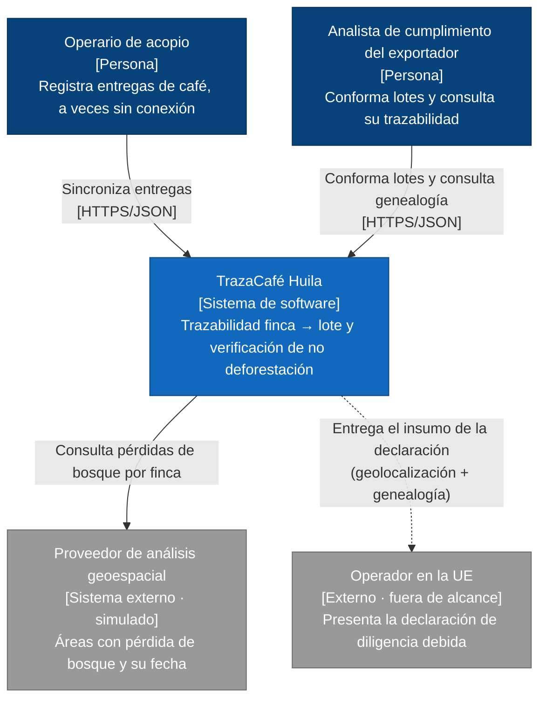
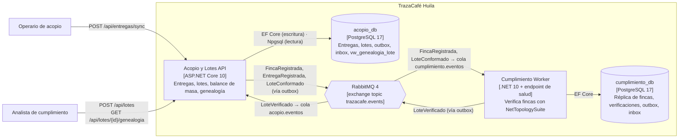
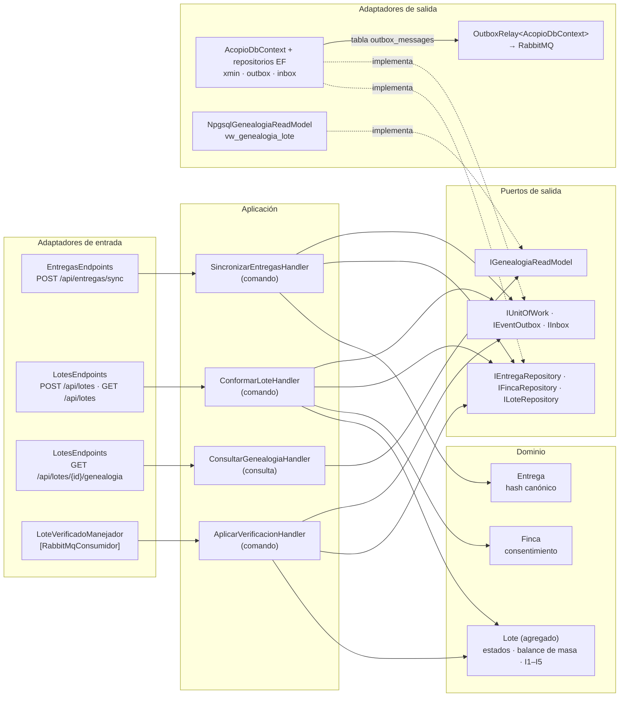
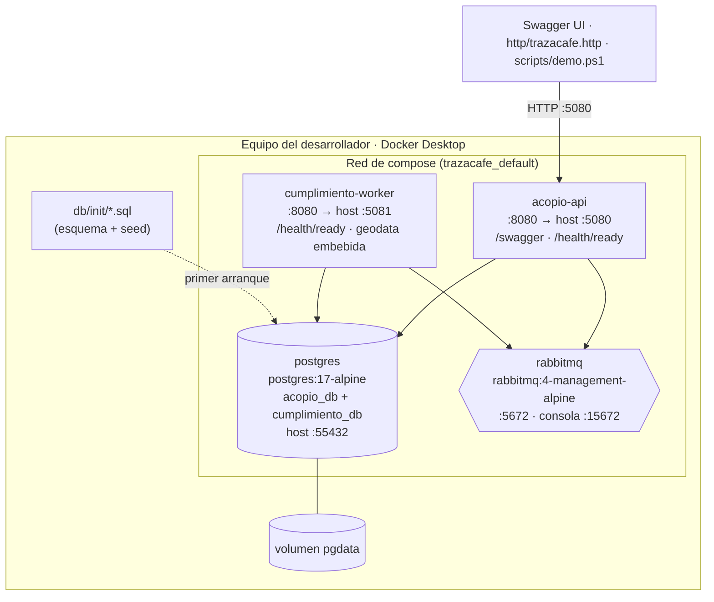
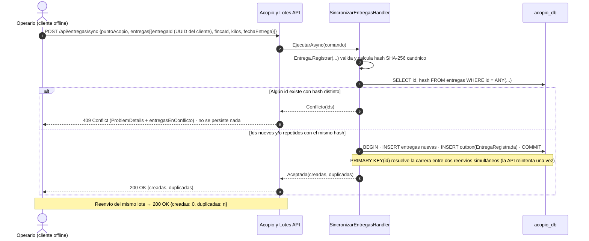
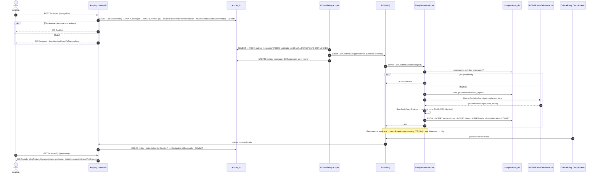

# TrazaCafé Huila — Diagramas de arquitectura (Mermaid)

> Se renderizan directamente en GitHub. Para exportar a PNG: `npx @mermaid-js/mermaid-cli -i diagramas.md -o out.md`.

## Figura 1. C4 — Contexto

## Figura 2. C4 — Contenedores

## Figura 3. Componentes — Acopio y Lotes (hexagonal + CQRS ligero)

## Figura 4. Despliegue local (Docker Compose)

## Figura 5. Secuencia — Sincronización idempotente (QA1)

## Figura 6. Secuencia — Conformación y verificación asíncrona del lote (QA2)

